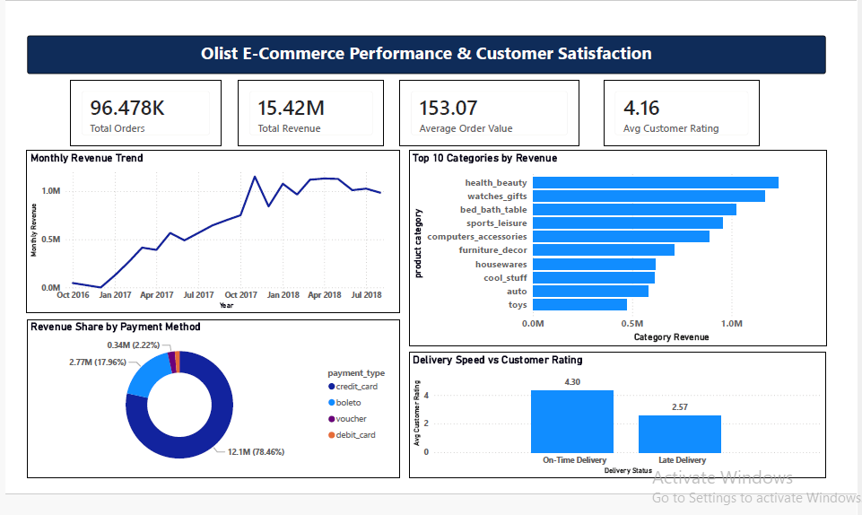

# Olist E-Commerce Sales & Delivery Analysis

I built this project to explore ~96.5K delivered orders from the Brazilian E-Commerce (Olist) dataset and see how sales, product categories, and delivery timelines impact customer reviews. 

Instead of doing everything in spreadsheets, I set up a proper workflow: cleaning the raw CSV files with **Python**, storing and querying the data in **PostgreSQL**, and building a clean one-page report in **Power BI**.

## Key Takeaways from the Data

- **Late deliveries tank customer ratings:** Orders delivered on time had an average rating of **4.30**, while late orders dropped to **2.57**. That is a 1.73-point drop just from shipping delays, making on-time delivery the biggest factor behind customer satisfaction.
- **Overall numbers:** Across **96,478 delivered orders**, total revenue reached **15.42M BRL** with an Average Order Value (AOV) of **153.07 BRL** and an overall customer rating of **4.16 / 5**.
- **2017 growth & Black Friday spike:** Monthly revenue grew steadily through 2017 and hit its highest peak in **November 2017** during the Black Friday sales rush.
- **What people buy & how they pay:** **Health & Beauty**, **Watches & Gifts**, and **Bed, Bath & Table** generated the highest revenue. For payments, **credit cards** made up the bulk of total revenue (~78%), followed by boleto (~18%).

## How I Built It

1. **Data Cleaning & Loading (`clean_data.py`):** Used `pandas`, `sqlalchemy`, and `psycopg2` to clean null values, fix timestamp formats, and load the tables into a PostgreSQL database (`olist_db`).
2. **SQL Queries (`analysis_queries.sql`):** Wrote joins and aggregations across the orders, order items, products, payments, and reviews tables to pull the core business metrics.
3. **Dashboarding (`Olist_Dashboard.pdf`):** Connected Power BI to the cleaned data to build KPI cards and visuals tracking monthly revenue, payment share, top 10 categories, and delivery SLA impact.

## Files in This Repository

- `clean_data.py` — Python script for cleaning raw CSVs and loading them into PostgreSQL.
- `analysis_queries.sql` — SQL queries used to answer the main business questions.
- `Olist_Dashboard.pdf` — High-resolution PDF export of the Power BI dashboard.
- `Olist_Dashboard.png` — Dashboard preview image shown above.
